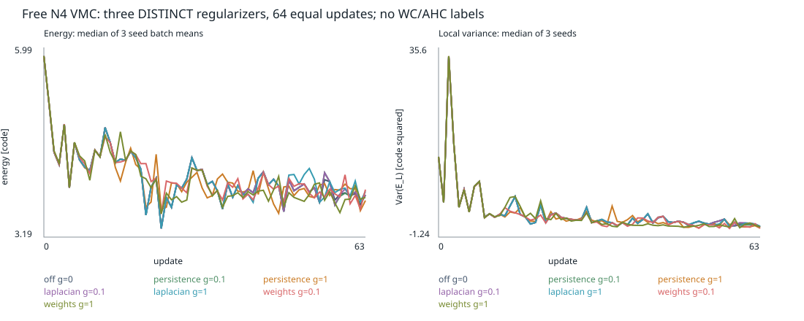
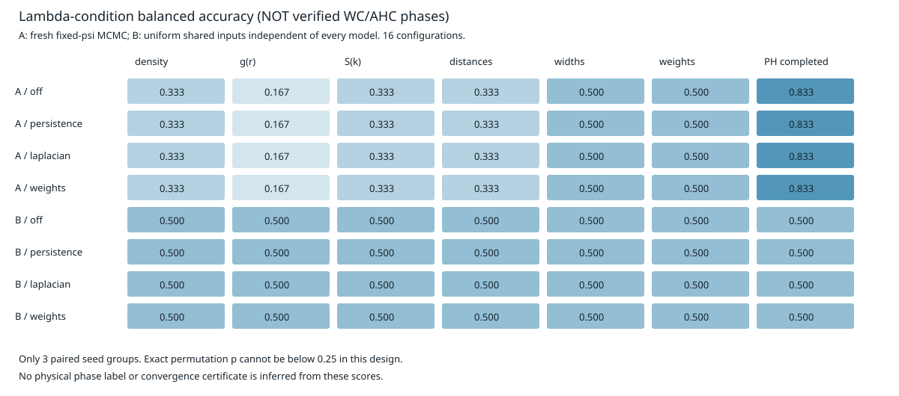
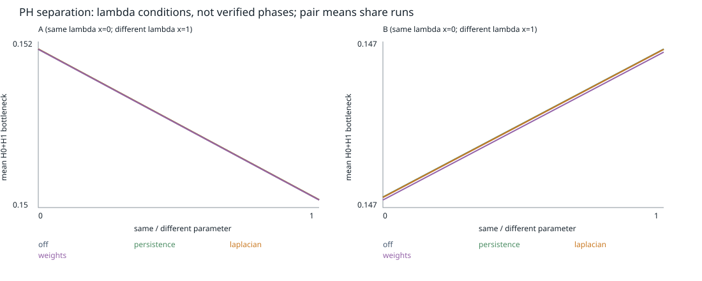
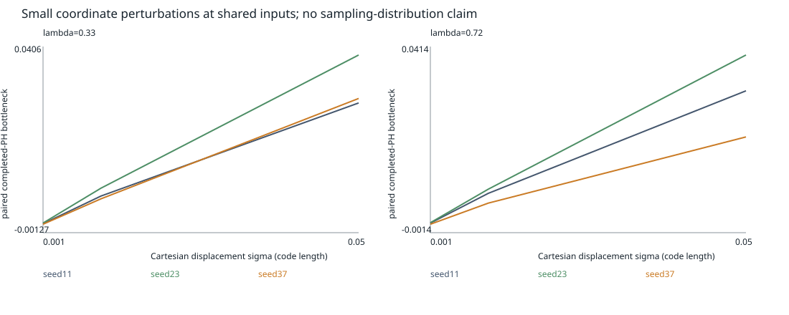

# G・lambdaベンチマーク実測結果（2026-10-26）

**正則化の一貫した改善、または頑強なWC/AHC識別を示す証拠は今回得られなかった。**
実学習・新規MCMC・群分割評価は完了したが、全候補は短時間学習で物理相未検証。
以下の分類値はlambda条件の識別であり、WC/AHC精度ではない。
実装・式・再実行は[README_topology_g.md](README_topology_g.md)。

## 採用する成果物

* [21本の小系正則化学習](topology_g_results_2026-10-26/summary.json)
* [35本のlambda学習](topology_benchmark_2026-10-26/summary.json)、[1334 checkpoint一覧](topology_benchmark_2026-10-26/checkpoint_inventory.json)
* [最終分類結果](topology_benchmark_analysis_2026-10-26_final/classification.json)、[距離](topology_benchmark_analysis_2026-10-26_final/distances.json)、[stress対照](topology_benchmark_analysis_2026-10-26_final/stress_comparisons.json)
* [C3測定](topology_benchmark_symmetry_2026-10-26_final/summary.json)
* [集計CSV](topology_g_benchmark_report_2026-10-26_final/regularizer_comparison.csv)、[識別CSV](topology_g_benchmark_report_2026-10-26_final/candidate_condition_metrics.csv)、[物理測定CSV](topology_g_benchmark_report_2026-10-26_final/natural_measurements.csv)
* [検証記録](topology_g_benchmark_report_2026-10-26_final/validation/verification.json)

図：

名前に`before_*`、`draft_plots`を含む出力および`_final`より前の解析ディレクトリは開発履歴。
特に初期の共有入力プールと測定乱数設計を修正し、上記`_final`のみを採用した。
古い出力やcheckpointは削除・上書きしていない。

## 小系G：3seed×7条件、64更新

N4偏極自由フェルミオン、正方形L=4、complex Screenformer（1層、2Head、幅16）、
Adam、batch16、通常ADの既存運動エネルギー。各seedで初期パラメータとサンプル乱数を対応付けた。
エネルギーは学習後の独立16 chain×32 sweepで再測定。単位は系全体のcode units。

| 損失 | gamma | E平均 ± seed SD | 局所E分散平均 | 更新時間中央値 ms |
|---|---:|---:|---:|---:|
| off | 0 | 3.77128 ± .08093 | 1.67956 | 2.609 |
| 真のPH | .1 | 3.77479 ± .08655 | 1.60945 | 3.221 |
| 真のPH | 1 | 3.82336 ± .11299 | 1.31362 | 3.238 |
| スペクトル代替 | .1 | 3.77379 ± .08525 | 1.55436 | 2.626 |
| スペクトル代替 | 1 | 3.81914 ± .10037 | 1.59851 | 2.752 |
| 重み平滑化 | .1 | 3.80263 ± .09515 | 1.35693 | 2.814 |
| 重み平滑化 | 1 | 3.77716 ± .12532 | 1.49162 | 2.631 |

全1344更新で非有限値なし。厳密基底E=3.70110165。有限MCの誤差を無視した変分上界判定はしない。
PH gamma1は分散を減らしたが、Eとseedばらつきは増えた。
モデルから独立な一様入力でのPH近傍consistencyもoff .010485→PH gamma1 .014733で悪化。
スペクトルgamma1では同指標.009360、重みgamma1では自身のconsistency .039527→.033620。
訓練損失、異なる分布での安定性、物理エネルギーが一緒に改善するとは限らない。
時間は最初の3更新を除くCPU実測で、同時プロセスの影響を統制した速度ベンチマークではない。
64更新の曲線と時刻は保存したが、収束速度の優劣を認定できる期間ではない。
三損失の尺度も異なり、同じgammaによるランキングは行わない。

## lambda系：実際の既存entry pointで35本、708更新

N9, rs15, lambda=.33/.72、3seed、off/PH/スペクトル/重み（有効時gamma=.1）を各24更新：24本。
窓幅2種、smooth7、Gaussian ring、Trim4、4Head、2層、N4の8stressを12更新。
解析的lower-band平面波Slater基準を2条件で12更新、lambda0候補を1本12更新。
全708更新で非有限値なし。Gと合計2052更新。

平面波基準は既存HFファイル形式で与えた**解析的基準**で、自洽HF・WC・AHCではない。
HF+小NNというansatz変更も含むため、初期パラメータのみを変えた対照とは解釈しない。
同じHamiltonianの検証済みWC型/AHC型競合状態やHalo基準は入手できていない。

38個の状態（最終35＋途中3）を復元し、A自然分布・B同一入力の計76 viewを解析した。
主分類から途中checkpointとstressは除外。学習終了後の短いfresh MCのエネルギーは、
off lambda.33でseed順に[1.592, -16.145, 27.225]、lambda.72で[75.257, 25.929, 66.899]。
局所分散は約2千〜1.4万。gamma.1の差は概ね1e-4程度で、物理的改善の証拠にならない。
Ha/粒子への換算はE/(N*rs²)。chain SEM・虚部・受容率はCSVと生配列に保存。

同じseed・12更新同士の初期ansatz対照では、lambda.33のEはrandom -2.614、平面波基準 -99.972、
lambda.72では37.916対-66.648。未収束であり基底相の比較には使えないが、
この実験では初期ansatzの影響が小さな正則化効果を大きく上回る。

## seedを分離した条件識別

16配置、各正則化につき6状態・3seed群、leave-one-seed-out。結果はgamma.1の4条件で同じ。

| 入力 | 特徴 | Balanced accuracy | AUROC | 95% BA区間 | 正確置換p |
|---|---|---:|---:|---|---:|
| A 自然分布 | PH raw/completed | .8333 (5/6) | 1.0000 | [.5,1] | .25 |
| B 共通入力 | PH raw/completed | .5000 (3/6) | .6667 | [.5,.5] | .75 |
| A | 密度 | .3333 | .3333 | [0,.5] | .75 |
| A | g(r) | .1667 | .0000 | [0,.5] | 1 |
| A | S(k)、距離統計 | .3333 | .1111 | [0,.5] | 1 |
| A | 幅/Trim | .5000 | .6667 | [.5,.5] | 1 |
| A | 重み分布 | .5000 | .5556 | [.5,.5] | .75 |

Bの密度・g(r)・S(k)・距離は同じ入力なので全モデルで同一、BA=.5/AUROC=.5。
F1、MCC、混同行列、8/16/32配置の結果もJSON/CSVに保存。
3seedでは置換検定の最小p=.25。全192比較のHolm補正pはすべて1。
bootstrapは既存OOF予測に条件付ける粗い区間で、[.5,.5]も確実性の証拠にはならない。
Aの5/6を独立seedへの頑強な物理相識別と結論してはいけない。

completed PHのBottleneck和を異なるseedのrun間で比較したoff結果：

| 入力 | 同lambda平均 | 異lambda平均 | (between-within)/(between+within) |
|---|---:|---:|---:|
| A | .152118 | .150542 | -.005208 |
| B | .146973 | .147257 | .000967 |

条件間距離は条件内距離を安定して上回らず、seed差が支配的。
Wasserstein、raw PH、各正則化でも出力を保存。これは物理相内/相間距離の代用ではない。

## 実施した頑強性と独立物理検証の範囲

| 軸 | 実施範囲 | 限界 |
|---|---|---|
| seed | 11,23,37、core全条件 | 3独立群のみ |
| 初期波動関数 | 平面波基準、同Hamiltonian2条件 | seed11のみ、ansatzも変化、HF相未検証 |
| checkpoint/収束 | 1/12/24更新の一部、履歴・fresh E | 長時間収束・精度別の群比較は未達 |
| 窓幅/形状 | short/wide、cos/smooth7/Gaussian ring | seed11・12更新のみ |
| Trim/Head/層/N | 指数4、4Head、2層、N4 | 一因子stress。N4対N9の同一配置比較は不可 |
| 配置数 | 8/16/32 | 同一run由来、独立run数は増えない |
| 座標摂動 | sigma=.001,.01,.05、off6状態 | 周期入力での局所感度。相保存の証明ではない |
| 液体/Halo | lambda0を1本、任意ラベル対応 | 液体認定なし、検証済みHaloデータなし |

stressの共通入力PH距離は同lambda・同seedの12更新baselineと比較し、更新回数の違いを混ぜない。
群分割APIのseed+factor除外はテスト済みだが、今回のstress数では物理相汎化の統計は出さない。

38状態の零twist C3期待値を測定。既存EwaldのC3整合誤差は最大7.39e-13。
一方、候補回転固有状態の残差は1.077〜3.492で小さくない。
例えばoff seed11で|<C3>|はlambda.33で.0233、lambda.72で.0407。
短いMC誤差も大きく、回転固有値・Chern符号・物理相の認定はできない。
実際のScreenformer状態を追跡するtwist-Hamiltonian族がないため、
多体Chern数と相再現性は**未検証**。A〜Fの独立QWZテストで得たChernをこれらの状態へ転用しない。

## 保全と検証

新規G関連14テストを含むA〜G計45テスト、既存probe6テストが通過。
真のPH座標と参照diagram、安定ペアリングでの有限差分、3モードの実ネットワーク勾配、
score項の独立2状態微分、off/gamma0のcallable同一性、共通入力、群分割・置換を確認。
既存float64 snapshot（902配列/21651要素）、float32+KFAC（1319配列/31142要素）は完全一致。
既存563checkpointのSHA256を再確認し変更なし。追加771件を含む全1334件は読込可能、
独立に検証済みの相ラベルは0。実行ログ・hash・図のXML検査は上記validationに保存。
SVGは構文検査済みで、画面/rasterによるレイアウト検査は行っていない。

今回達成したのは、既存物理計算を維持した診断・正則化・実験基盤と、小規模な否定的/限定的結果の数値化。
WC/AHCの頑強な相識別と正則化による物理相再現性の向上は、未達の研究仮説として残る。
次に必要なのは独立に認定された競合相の収束状態と、十分な独立seed/run数での事前固定評価である。
