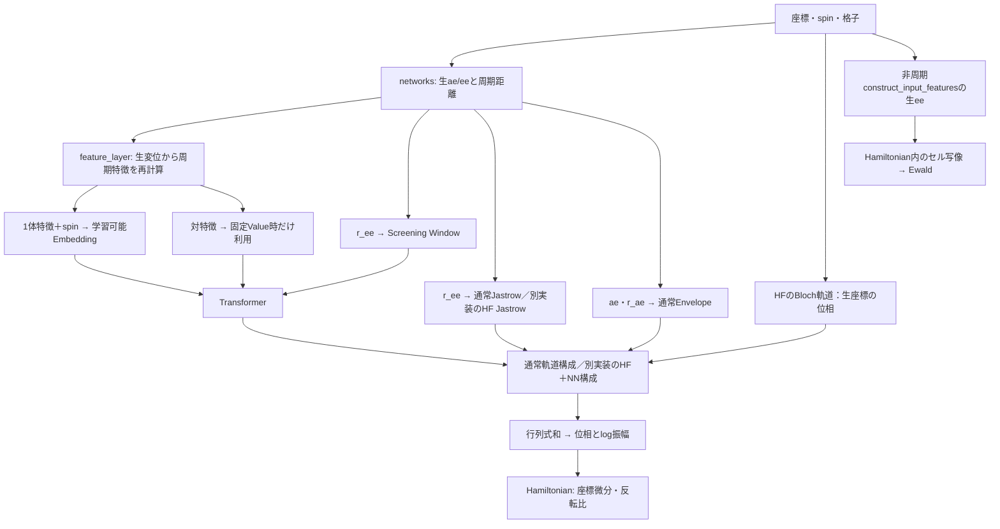

# 検証対象・再現性・既知問題

独立CPU環境での最新の数値実行結果・固定snapshotは `RESULTS.md` 冒頭と `cpu_validation/` を参照。
初期の依存不足は解消。K04/K07はG1、K03はG2b、R08はG2cで修正済み。未解決項目と履歴は下表・末尾の段階別記録を参照。

## 代表経路

| 系 | 実行入口 | trainer | Ansatz / 局所エネルギー |
|---|---|---|---|
| 通常PeriodicWave | `configs/run_2deg.py` | `train.train` | CustomPsiformer または SlaterNet / `pbc.hamiltonian` |
| Screening | `configs/run_2deg_screen.py` | `train_screen.train` | CustomScreenformer / `pbc.hamiltonian` |
| λ-jellium | `configs/run_lambda_jellium.py` | `train_screen.train` | CustomScreenformer / `pbc.lambda_jellium` |
| HF軌道＋NN補正 | 同上、`PW_LJ_HF` 指定 | 同上 | `lj_orbitals.make_lj_orbitals` / `pbc.lambda_jellium` |

上記の実行スクリプトはimport時にも設定作成・結果保存・学習を開始する。
テストではimport/実行しない。静的に入口を確認し、統合テストは小さなConfigDictで同じtrainerの分岐を通す。
これは引数解析や全プリセットを実行したという意味ではない。

## 今後も保存する仕様

- `Network.apply` は `(sign, logabs)`、複素なら `(位相角, logabs)`。位相の比較は `exp(iθ)` でも行う。
- 全電子をまとめたN×N軌道行列の複数行列式の和。スピン別ブロック行列式には変更しない。
- 交換では位置と内部状態を同時に交換する。λ-jelliumの `(N,0)` は固定擬スピンを意味しない。
- 格子ベクトルは列。波動関数の周期ノルムとEwaldの実空間変位・最小像距離は役割が異なる。
- 一様2DEGでは面積πN、相互作用係数r_s、Haへの換算はE_code/r_s²。モアレはプリセット別の換算（F0の単位表）。
- Ewaldの背景電荷・Madelung・自己項・係数・打切り、複素微分の非共役二乗を保つ。
- λ-jelliumの重み付きラプラシアン、Δn_-、反転比と微分、Im E_Lを保持する。
- 初期化のkey分割順、parameter treeとdtype、eps、窓の基準長の格子点走査を保持する。
- Trim、窓、自己項、固定value、TanhNorm、ゲート、出力倍率は別設定。滑らかさの変更もモデル変更。
- clipping後の勾配と、clipping前の報告エネルギーを区別する。
- MCMCの標的は|ψ|²。位置移動→擬スピン反転の順と乱数使用を保持する。
- 学習で評価したエネルギーは更新前パラメータに対応。保存されるパラメータは更新後。
- KFAC固有の登録、曲率推定、pmap集約は単なる汎用ラッパーとして削除しない。

## 再現に必要な情報

`python3 -m tests.baseline inspect` は本体をimportせず、ソースhashと環境をJSONで表示する。
今回採取した値は `source_baseline.json`。不明な過去runの環境値を推測で埋めない。

| 項目 | 必要な情報・現行の制約 |
|---|---|
| 物理系 | 電子数、内部状態の意味、格子、単位、r_s、λ、Δ、外場、Ewald打切り |
| NN | 全構造、行列式数、複素出力、特徴量、Envelope、Jastrow、窓・固定value・HF設定 |
| 環境変数 | `PW_*`の全名称をソースから採取。JAX/XLA/デバイス関連設定も記録 |
| モジュール状態 | `TRIM_MAX`、`TRIM_POW`、`WIN_SHAPE`、`FREEZE_W`、`CLIP_R`、`CLIP_BETA`、`mcmc.PIN`。HF Jastrowの`ALPHA0`等はソースhashも必要 |
| 初期化 | seed、JAX版、乱数分割順、通常Gaussianかsite周りか、擬スピン初期値 |
| HF外部表 | 6列の内容、順序、k/Gの意味、λ、内容SHA-256。パスだけでは再現できない |
| 学習 | optimizer全設定・状態、lr schedule、batchとdevice数、clipping、chunk、反転batch、burn-in、移動幅と調整 |
| checkpoint | `t,data,params,opt_state,mcmc_width`。復元はt+1。PRNG状態を保存しない |
| 解析 | 同じ実効モデル設定、checkpoint識別、全walkerの位置とスピン、HF表、介入、seed・再サンプル条件、キャッシュの由来 |

`PW_WIN_SHAPE` / `PW_TRIM_POW` / `PW_FREEZE_W` はモジュールimport時に読む。
設定だけ変更して同一プロセスの古いJITを再利用すると、異なる挙動が残る可能性がある。
モデル構築前の設定値と、trace時のグローバル値を区別する必要がある。

実際の過去checkpoint・HF研究表は今回のリポジトリに含まれておらず、その復元は未検証。
外部表のhash確認例（読込のみ）：`shasum -a 256 /path/to/hf_table.txt`。
テスト用HFは一時領域に生成し、数値基準にその数値内容を収録する。

## 既知問題の台帳（この段階では修正しない）

| ID | 経路と問題 | 再現・確認方法 |
|---|---|---|
| K01 | 主要3入口はE1/E2a/E2bで正式Diagnosticへ移行済み。旧Trim²/cos固定との比較は保存参照へ移した。他の解析には再実装が残る | `test_known_attention` の2件は現在PASS。旧差の数値はRESULTSの各段階を参照 |
| K02 | `mh_block_update` は `mh_accept` に7引数、現在の定義は9引数。戻り値も4対5 | 静的なPython引数bindを実行。数値試験では実際のblocks>1経路のTypeError |
| K03 | G2bで通常PBCの複素folx経路の実部化を除去 | 複素Gaussian/周期関数の実部・虚部が解析式/defaultと一致。旧数値・旧ソースは保存 |
| K04 | G1で実数VMCの係数2欠落を修正 | E=tanh(2θ)の厳密微分2に実数・複素の双方が一致。旧コード・数値基準は保存 |
| K05 | `NoneMoire` は `_e_l` を構築せず返そうとする | UnboundLocalErrorの再現試験 |
| K06 | 定数logabsの平面波で通常folx運動項がArrayの `.laplacian` を参照 | 数値ERRORとして記録。default経路は成功 |
| K07 | G1で余分な位相項を修正 | E=-sin(2θ)の厳密微分−2に一致。既存diffを直接共役収縮。clipping方式は変更しない |
| K08 | x64有効のScreening系KFACでmask_omega/out_scaleのfloat64/float32不整合 | 数値ERROR。float32の全5経路では学習・復元・厳密再現に成功 |
| K09 | Psiformer folx/Hessianに約1.8e-7の差 | 既存FAILを維持。許容誤差で消さず primitive/trunk/波動関数へ局在化する |
| K10 | custom JVPのaux tangentが零方向でも非零。complex primalの出力dtypeも通常/JVPで異なる | check_vmc_gradientsで再現。主勾配K07の原因と分離し未修正 |
| I01 | PBC r_ae shapeとisotropic Envelopeの不整合 | F0のKnownInconsistencyで再現。修正せず主要null経路と分離 |
| R01 | `to_json_best_effort` がNumPy配列を文字列化 | 実際の保存関数を一時ファイルに実行する試験 |
| R02 | λ-jellium等でconfig保存後にdeterministicを有効化 | ソースの実行順序を静的確認 |
| R03 | checkpointにPRNG状態がない | 保存引数の静的確認・数値roundtrip。中断なし計算との乱数軌道一致は保証しない |
| R04 | deterministic時の通常trainerは42固定、screen trainerだけPW_SEEDを読む | 本体のseed式を抽出してPW_SEED=91で評価する静的契約試験 |
| R05 | 共通samplerは擬スピン反転を指定しない。SlaterNetの再構築にも専用分岐なし | ソース確認。新しいテストは本体の各Ansatzを直接構築し、このloaderを使わない |
| R06 | 未移行の解析には条件不十分なキャッシュが残る。主要3入口はversion付き新名・排他保存・明示設定・hashを使用 | 旧キャッシュを削除/上書きせず、移行済み入口と他を区別する |
| R07 | PINは通常の|ψ|²サンプリングとして使えない。モデル介入は標準基準と混ぜない | 標準基準はPIN=None / CLIP_R=None。拘束計算の正当性は認定しない |
| R08 | G2cで両trainerの報告用実数energyを分離 | 旧/新の実数・複素/両精度/default/folx 16条件、λ診断2条件で保存状態厳密一致・実CSV/EW/log正常。raw loss/complex auxは保持 |
| P01 | `find_packages()` と `pbc/utils` の `__init__.py` 不在により配布物収録に懸念 | ソース確認のみ。wheel作成・配布テストは今回未実行 |

G2b後の既存33件のXFAILは0。K03/K04/K07は修正されPASS。K01の2件はE1以後PASS（旧式の比較記録は保持）。
Psiformerのfolx/Hessian間には約1.8e-7の差もあり、許容誤差を緩めずFAILを残す。
`expectedFailure`は他の実行エラーも期待失敗として扱うため、依存/API不整合時はtracebackを確認し、
必要ならそのテストのデコレータを一時的に外して原因を切り分ける。通常経路の対照試験も必ず併用する。

## 承認された段階計画と停止位置

F0で文書と不足テスト、F1で学習可能Embeddingを共通化した。F2aで周期距離の分離を採用し、F2bで用途別の責務と変更範囲を調査した。F2bまでは本体変更なし。
F3で通常make_orbitalsだけをwavefunction.pyへ移動した。F4（必要な新Ansatz接続）、F5（Hamiltonianの境界整理）は未実施。
LayerNorm、Screening Attention、正式Diagnostic、主要3解析入口の移行は完了している。
学習ループ統合や物理問題の修正はこの順序に自動で含めず、別途承認を得る。

## F0：4領域の現行インターフェース（2026-10-24）

以下は現行の数値仕様。F1では学習可能Embeddingの実装場所だけを変更した。FermiNetDataはkeywordで構築するmapping dataclass。単一walkerを記す。N=電子数、d=次元、A=原子数、E=stream幅、K=行列式数。
Productionは通常のNetwork.apply。Diagnosticは同じソースの独立再評価で、Production内部のビット列ではない。

### 入力・幾何・特徴・Embedding

| 対象 | 数式/入力→出力 | dtype・単位・params |
|---|---|---|
| FermiNetData | positions [N*d], spins [N], atoms [A,d], charges [A] | 座標/格子は実数、コード長さ単位。spinは現在±1を実数配列として渡す。atoms/chargesは主要周期系ではghost/0 |
| 生の幾何 | ae_iA=r_i-R_A [N,A,d], ee_ij=r_j-r_i [N,N,d] | `networks.construct_input_features`。距離はEuclid、r_ae [N,A,1], r_ee [N,N,1] |
| 周期幾何 | 同じ生変位と周期距離 | `networks.make_periodic_construct_input_features(L)`。**現行r_aeは[N,A]**、r_ee [N,N,1] |
| 周期特徴 | f_one [N,F1], f_pair [N,N,F2] | `pbc.feature_layer.make_pbc_feature_layer`。init()->((F1,F2),{}); RNGなし |
| 学習可能Embedding | X=concat(f_one, spins[:,None]) @ W_embed [N,E] | W_embed [F1+1,E]、biasなし。params['layers']['input']と['embed']を維持 |
| 固定Value用特徴 | pair=concat(f_pair[...,:1]/d_ref,f_pair[...,1:]) | 距離だけ無次元化。通常Valueでは使わない。現在は特徴層を再度評価する |

Lは列に格子ベクトルを持ち、u=L^-1 r、G=L^T L。
`a=1-cos(2πu), b=sin(2πu), d_per=sqrt(a^T G a+b^T G b)/(2π)`。
最小像Euclid距離ではない。r_eeは対角評価前に分率座標へeyeを足してからnormを計算し、最後に(1-eye)を掛ける。
この順序を`where`やnorm(0)へ変えず、対角の値・1階・2階微分の保護を維持する。

1体特徴は原子ごとの `[sin(2πu_iA), cos(2πu_iA)]` をflattenし、include_r_ae=Trueなら先頭にd_perを付ける。
F1=A*(2d+include_r_ae)。rescale_inputs=Trueでは1体距離のコード単位数値だけlog(1+d_per)へ変える。
sin/cos・spinは無次元。特徴配列には距離と無次元成分が混在し、学習可能W/Xには独立した固定物理単位を課していない。
電子対特徴は `[d_per, sin(2πu_ij), cos(2πu_ij)]`、F2=2d+1。sin部分は対の向きに依存し、対称行列性は要求しない。
ラベル置換Pに対してone'=one[P], pair'=pair[P][:,P], spin'=spin[P], X'=X[P]。電子の個別格子移動には周期的。
連続並進・回転・任意spin回転の不変性をAnsatz全体へ一律に要求する仕様ではない。

**演算順**：周期幾何はrec=2π*inv(L)からrec/2/πで分率座標を作り、特徴層はinv(L)から直接作る。
特徴層は入力距離をそのまま使わず再計算する。代数的に等しくても浮動小数点演算は同一とは限らない。
geometry戻りtuple順は(ae,ee,r_ae,r_ee)、FeatureApplyの引数順は(ae,r_ae,ee,r_ee)なので、受渡しはkeywordで行う。
原子原点での1体距離の微分は保護されていない。include_r_ae=Falseは均一系のghost原子に不必要なcuspを入れないために使う。

3 Ansatzの初期化は外側の軌道initからtrunk用subkeyを受け、feature用split（subkey未使用）→embedding用split→block用splitの順。
embeddingのlinear init内部もsplitし、key1でnormal/sqrt(in_dim)を作る。blockには最後のsplitの**key側**を渡す。
未使用splitの削除やsubkey側への変更は不可。PBC featureのparamsは現在空dict。将来のlearned featureでRNGが必要なら新モデルの契約になる。
weightのdtypeはJAXの初期化設定に依存する。暗黙のfloat64化/float32化、eps・matmul精度・JIT設定の変更を行わない。

F1の共通入口は`network_blocks.init_input_embedding(key,F1,E)`と
`apply_input_embedding(W,f_one,spins)`。初期化は裸のWを返し、既存のlayers.embedへ格納する。
forwardはconcat→dotだけ。FeatureLayer.init/apply、キー分割、Transformerへの接続は各Ansatzに残す。
同じshapeの学習可能射影を試す場合はこの2関数を確認する。特徴式・PBC・固定Valueは別の変更境界であり、
新しいEmbeddingの数式を試すこととF1の数値同等な関数移動を区別する。

ScreenformerはXと周期幾何のr_ee[...,0]をAttentionへ渡す。固定Valueでは対特徴も渡し、D=F2となる。
d_refは現行のNumPy float64格子点走査（2Dは201×201、endpoint=False）で得る最大周期距離。解析的最大値に置換しない。
Psiformer/SlaterNetの通常streamは1体特徴のみ。Embedding幅を保つ変更はAttention/Hamiltonianの式を変えずにできるが、
F1/F2/Eの変更は関連weight shape・固定Value・checkpointとの整合が必要。

### Wavefunction Construction

`networks.make_orbitals(nspins, charges, options, equivariant_layers)`が通常の軌道factory。
trunk h [N,E] → 必要ならPRE_ORBITAL Envelope → 線形射影 → 複素packing → PRE_DETERMINANT Envelope → reshape/transpose。
出力は行列のlistで、通常は単一要素Phi [K*max(states,1),N,N]。
complex_output=Trueなら線形出力の偶数/奇数成分をRe/Imとして結合する。

`Psi=sum_k det(Phi_k)`を`network_blocks.logdet_matmul`で評価する。現在の標準呼出しでは行列式重みを渡さない。
通常のfloat32/64射影はcomplex packingでcomplex64/128となり、戻る位相/log振幅は対応する実精度。
complexでは(phase angle,log|Psi|)、realでは(sign,log|Psi|)。角度は分岐があるためexp(i*phase)も比較する。
1x1行列式の特別経路、max-log安定化、和の縮約順も保持する。
N×Nの全電子行列をspin別の積へ変更しない。位置と内部状態の同時交換でtrunk/軌道行が共変となり、行列式は反対称。
paramsはlayers,orbital（1要素list）、envelope、必要ならjastrow。型・key・list順・乱数順を保持する。

通常JastrowはJ=`sum -g*alpha²/(alpha+d_per)`（2D parallel cusp g=interaction_strength/3）。
**make_orbitalsはnspinsを(N,0)へ統合してJastrowに渡すため、現在は全対がparallelである。**
入力spinの符号でanti成分を切り替える変更は物理モデル変更。現在のee_antiはこの経路では使われない。
通常alphaはshape[1]のonesで初期化して直接使う。HFのsoftplus制約へ統一することも別の数値/モデル変更。
各行列要素へexp(J/N)を掛けることでdetへexp(J)が作用する。直接log振幅へ加える書換えも、演算順を変えるので移動と混ぜない。

HF経路は`lj_orbitals.make_lj_orbitals`。
`Phi^k_ij = phi_HF_j(r_i,s_i)+net_scale*delta_phi^k_j(r_i,s_i)`、NNの+/-成分を実際のs_iで選ぶ。
`phi_HF=e^(ik_j.r) sum_G c_j(G) u_(k_j+G)(s) e^(iG.r)`、u=(1,lambda*q_+)/sqrt(1+lambda²|q|²)。
HF Bloch因子の境界位相はkとsimulation格子の整合に依存し、特徴の周期性だけでは任意の外部表の周期境界条件を保証しない。
HFのNk=Nを要求。6列表(kx,ky,Gx,Gy,Re c,Im c)の順序・hash・lambda・格子が必要。パスだけでは再現しない。
専用JastrowはJ=`sum_(i<j) -g_ss*alpha_ss*exp(-d_per/alpha_ss)`、alpha=softplus(theta)。
実際の動的擬スピン対++/--/+-で分岐し、通常のmerged Jastrowとは別物。
HFのtheta初期値はinverse-softplus(ALPHA0=0.3)、shape[1]。HF側paramsはlayers/orbital/jastrow_ssで、通常Envelopeを追加しない。orbitalsへexp(J/N)を掛ける点だけ共通。
lambda系のnspins=(N,0)は擬スピン固定ではない。許される内部状態はMCMCの反転提案とも整合させる。

節ではlog微分・局所エネルギーが未定義/発散し得る。near-nodeのdiag(1,t)ではlog|det|=log|t|、微分1/t、2階微分-1/t²。
全detが特異な場合は現行max-log安定化がNaNを返すことがあり、非特異det同士の相殺ではlogabs=-infになることもある。
位相は節で意味を持たず、clamp/epsilonで隠さない。rank検査で全ての相殺節を検出できるわけではない。
4電子・幅4・初期最終LN・null envelope・軌道biasなしの特異条件も既存Diagnostic試験で区別する。

**I01：PBC幾何r_ae [N,A]とisotropic PRE_DETERMINANT Envelopeの要求shapeに不整合。**
F0のN=3/K=2/complex例ではbroadcastエラーを再現する。非周期r_ae [N,A,1]の対照は独立式に一致する。
主要なPBC null-envelope経路は別に検証済み。この再現テストのPASSをPBC非null Envelopeの正しさと解釈しない。
F0ではshapeやEnvelopeを修正しない。

### Hamiltonianと単位

共通の外部入口は `local_energy(f, ...)-> e_l(params,key,data)->(E_L,aux)`。
fはProductionのNetwork.apply。HamiltonianはAttention/Embeddingの内部量を参照しない。

| 系 | 演算/必要情報 | 戻り値と単位 |
|---|---|---|
| 通常2DEG | -1/2 sum lap Psi/Psi + g*Ewald。位相/log振幅の座標微分 | aux=None。標準rsプリセットは長さrs*a_B、面積πN、g=rs、E_Ha=E_code/rs² |
| CoulombMoire | 上記+V_M、V_M=-2U sum_(i,n=1..3) cos(G_n.r_i+phi) | aux=None。run_2deg_moireはrs系コード単位のU。triangular_potentialのconvert_moire_scalesは長さa_M、エネルギーhbar²/(m_eff*a_M²)→meVで別換算 |
| lambda_jellium | -sum c_i lap_i Psi/Psi + Delta*n_- +反転項+Ewald | 複素E_L、既定aux=[V,n_-]。lambdaはコード長さ、Deltaはコードエネルギー、既定Delta=rs |

a=log|Psi|, theta=phaseの複素運動項は
`T=-1/2[lap a+sum(grad a)^2-sum(grad theta)^2+i(lap theta+2 grad a.grad theta)]`。
`hamiltonian.local_kinetic_energy`のdefault/folxはこの複素式を実装する。
**pbc.hamiltonianの複素folx枝だけは最後にrealを取る**。defaultとの既知の相違を共通化で黙って消さない。
定数log振幅のfolx .laplacian ERRORも別の既知問題。defaultだけの解析解PASSでfolxを認定しない。

Ewaldは生のeeを `(u+0.5)%1-0.5` で分率セルへ戻し、実空間変位として評価する。斜格子でこれを一般の最短像と断定しない。
`gamma=(2.8/sqrt(area))²`、実/逆空間打切り・順序・q=0除外を保持。
`V=g*[sum_(i<j) v_pair + N*Madelung/2 - N²*phi_q0/2]`。背景・自己imageを含む。
現在のEwaldはjellium用でatoms/chargesを使用せず、電子-イオン相互作用の実装ではない。
電子対特徴のd_perをCoulombの実空間ノルムへ代入しない。potential内の実数化と、複素運動項の虚部欠落は別問題。

lambda系はc_i=1/2+Delta*lambda²*[s_i>0]。
反転S^(i)に対し、`ratio=exp(logabs_flip-logabs+i*(phase_flip-phase))`と、**反転後**log Psiの
`D_i=d_x_i-i*s_i*d_y_i`を使い、`i*Delta*lambda*sum ratio*D_i log Psi_flip`を加える。
weighted Laplacianはgrad(log Psi)の非共役二乗を使う。folxはsqrt(c)座標変換、defaultは電子別JVP。
局所エネルギーは粒子ラベルの同時置換に不変であるべきだが、その実現は渡す波動関数と演算子の対称性に依存する。
auxのVはエネルギー、n_-は無次元の個数で、保存配列dtypeはpositions.dtype。
解析用make_energy_componentsの[T,K,C,F,V]はaux=[V,n_-]とは異なる。物理的な内訳とログ付随量を混同しない。

### 共通基盤との依存と互換性

- Attentionはstream幅・対特徴次元に依存。新しいEmbeddingでshapeが同じでも周期性・共変性は独立検証する。
- 新Ansatzは既存のequivariant_layers init/applyを受ける軌道factoryとして接続できる。現行factory選択は組立側にある。
- Hamiltonianは波動関数APIだけに依存するが、lambda/Delta/rs変更はHFスピノル・Jastrow cuspと物理的に関連する。
- 内部状態/非対角演算子変更時にはMCMCの提案・到達可能状態の確認が必要。標的|Psi|²・乱数順を勝手に変えない。
- dtype・tree・キー・外部表・格子を維持した関数移動は既存checkpointの評価を厳密比較。入力/軌道次元変更は新モデルとして扱う。
- PRNG未保存のためresumeは中断なしの乱数軌道と同一とは保証しない。過去の研究checkpoint互換性は実データ未入手で未検証。

## F0：位相VMC勾配の独立調査計画（最優先・未修正）

目標の非clipping勾配は、O=partial_param log Psiとして
`g=2 Re <(E_L-<E_L>)*conj(O)> = 2[<Re(deltaE)*partial a>+<Im(deltaE)*partial theta>]`。
局所値の虚部の平均が0でも、位相との共分散は0とは限らない。
K07は純位相で現行-4/厳密-2、複素振幅の対照は2/2。単一の学習率調整では済まない。

| 順序 | 小さな独立検証 | 比較・切分け |
|---|---|---|
| 1 | 二状態の完全和：psi_s=exp(alpha*x_s+i*theta*x_s)、実対角Hと虚非対角Hermitian H | 正規化期待値を直接AD/中心差分。alpha/theta/混合パラメータを区別。固定標本平均の微分を正解にしない |
| 2 | 完全和からE_L=Hpsi/psiとOを独立計算 | 上記共分散式のRe/Imを別表示。位相の符号とcomplex conjugateを確認 |
| 3 | custom JVPへ純振幅・純位相・混合の単位tangentを入力 | `diff`、`clipped_energy`、`clipped_el=diff+clipped_energy`、term1、term2を紙/テスト参照で展開。原因確定前に式を置換しない |
| 4 | clipping=0を最初に固定。その後median/mean中心、center_at_clipped、cutoffの内外 | clippingありは一般にバイアスを持つ更新規則。非clippingの厳密エネルギー微分と同一視しない。報告平均と更新用中心を分離 |
| 5 | 複素E_Lを保持/実部化した対照 | Hamiltonianの虚部欠落(K03)とJVP係数(K07)を分離。default/folx/lambdaを混ぜず順番に比較 |
| 6 | dtype、batch複製、chunk、device平均、global phaseのみのtangent | 2倍のbatchで勾配が2倍にならないこと、global phase勾配0、複素位相のbranch cutを避けた差分 |
| 7 | 小規模Productionの固定入力で複数方向微分、短い独立学習 | scalar covariance/JVP/Adam/KFACを段階別比較。修正承認後は旧基準を保持し新バージョンで比較 |
| 8 | 過去runの影響評価 | 実効Hamiltonian経路、複素flag、位相依存params、clipping、optimizer、checkpoint/環境を特定してから解釈する |

F0ではこの計画を作り、既存K07 FAIL等を保持する。本体修正・許容誤差緩和・不具合経路の除外はしない。
K07/K03/K04を先に解明し、その後folx平面波/Psiformer微分、倍精度KFACを切り分ける。
I01や再現性・MCMC問題も別タスクとして扱い、構造移動へ混ぜない。過去結果全てが誤りと断定する根拠にはしない。

## F2a：周期ノルムは用途別の独立実装を維持（2026-10-24）

**数学kernelは同一。ただし研究上の変更境界を独立に保つため共通化しない。**
これは共通化不能・数値同等性不可能という結論ではない。kernelだけなら呼出し側の順序を維持して共有する余地はある。
その共有はノルム定義の変更をAttention/Jastrowと特徴量へ同時に伝播させる依存になる。
今後、周期距離表現を別々に研究する目的に対して、現在の2箇所をそれぞれ管理する方が自然と判断した。

Lは列格子、G=L.T@L [d,d]、uは分率変位 [...,d]。
両kernelはa=1-cos(2πu)、b=sin(2πu)、D(G,u)=sqrt(aᵀGa+bᵀGb)/(2π)。
出力は[...]、長さのコード単位。短距離で実空間ノルムに一致するが、最小像距離ではない。
実行文のASTは同一：rank検査→a→b→2つのeinsum→和→sqrt→(1/(2π))の乗算。
原点では|r|型のcuspがあり、全域で微分可能な距離と表現しない。

| 実装境界 | 入出力と目的 | 変更する際の場所 |
|---|---|---|
| networks.make_periodic_construct_input_features内のlocal periodic_norm | pos[N*d], atoms[A,d]からae[N,A,d], ee[N,N,d], r_ae[N,A], r_ee[N,N,1]。Screening距離、通常/HFのJastrow、軌道/Envelope入力へ渡す | networks.pyのfactoryとその呼出し元。Attentionだけを変更したい場合はこの共有範囲を先に考慮する |
| pbc.feature_layer.periodic_normとmake_pbc_feature_layer | raw ae/eeから特徴を生成。渡されたr_ae/r_eeをそのまま使わず再計算。f_one[N,A*(2d+include_r_ae)], f_pair[N,N,2d+1] | pbc/feature_layer.py。3 AnsatzのEmbedding入力とScreenformer固定Valueへ影響する |

幾何側はrec=2π*inv(L)を作り、rec/2/πで変換する。特徴側はinv(L)を直接使う。
それぞれfactory構築時に格子/metric/逆格子を計算してclosureへ保持する。既存JITへ新しい格子を渡す設計ではない。
格子変更時はfactoryと対応JITを作り直す。構築をJIT内で行う既存呼出しでは、その構築自体がtraceされる。
数値型は入力とJAXのpromotion/default dtypeによる。eyeのdtypeも既存のまま。パラメータ/RNGはない。

両側ともs_eeの対角にeye(N)[...,None]（全座標に1）を加え、ノルム評価**後**に1-eye(N)を掛ける。
末尾1軸を付けるのは幾何側r_eeの返却時。特徴側はr_ee[...,None]をsin/cos特徴と連結する。
epsilon、where、stop_gradientによる原点正則化はない。r_aeにも保護はない。
整数シフト点は数学上も周期ノルム0であり、この保護は浮動小数点のsin(2π)残差と最後のmaskの演算に依存する。
「eyeを足す」を非周期距離のように有限距離への移動と解釈したり、先に厳密0へ置換したりしない。
通常配置で対角の値/1階/2階微分0を確認したが、**別電子が一致する特異配置までは保護しない**。
その場合、jacfwd(jacrev(距離行列))でNaNが対角出力のHessian成分へ伝播することも実測した。今回修正しない。

Screenformerは幾何のr_ee[...,0]をWindowへ渡す。固定Valueの距離成分は特徴側で再計算したもの/d_ref。
d_refのNumPy格子走査は別処理であり、学習可能距離や連続最適化へ置換しない。
Ewaldはraw eeを中心セルへ剰余写像した後、各像へのEuclid距離|r-R|を使う。
中心セルへの写像は斜交格子での真の最小像選択とは限らない。周期ノルムへの置換も、単一最小像への置換も不可。
最小像距離min_n|r-Ln|は別の量。moire_analysisは近傍9像を探索する解析実装であり、今回触らない。

F2aの数値測定・特異条件・未再実行項目はRESULTSのF2a欄、再現入力とソースはf2a_validation/。
F2bは大きな幾何factoryへ統合する前提を外し、ae/ee生成と各距離の責務を確認する調査から始める。

## F2b：周期幾何・距離・特徴量の責務境界（2026-10-24、設計調査のみ）

### 入力から各物理量への流れ

N=電子数、A=原子数、d=次元、K=行列式数、E=trunk幅。pos[N*d]とatoms[A,d]はコード長さ単位。
spins[N]は内部状態であり座標の一部ではない。格子L[d,d]は列ベクトル。
生変位はae_ia=r_i-R_a [N,A,d]、ee_ij=r_j-r_i [N,N,d]。
geometryはposを全てセル内へwrapしてから差を取る実装ではない。ae/eeは生変位のまま返す。
周期性は用途ごとの分率変換・sin/cos・周期ノルム、またはEwald内の剰余写像で与える。

図の通常/HFは選択される別経路であり、同じfactoryへ統合する案ではない。
4領域は完全に無依存ではない。特徴次元とAttention幅、spin表現とHF/反転演算子、
相互作用とcusp、格子とHFのk/Gには必要な物理的整合がある。これを隠す共通geometryオブジェクトを導入しない。

### 主要関数と利用先（対象10ファイル）

| 場所・関数 | 計算と出力 | 利用先・責務 |
|---|---|---|
| networks.make_periodic_construct_input_features / 内部construct_input_features | 生ae/ee、周期r_ae[N,A]、対角mask後r_ee[N,N,1]。local periodic_normの式・順序はF2a欄 | make_orbitals、HF make_lj_orbitals、正式Diagnosticのgeometry |
| networks.construct_input_features | 同じ生ae/eeとEuclid距離。r_ae[N,A,1] | 通常/HF以外の非周期軌道構成、PBC Hamiltonianの生変位入力。Hamiltonian側は返された距離を捨てる |
| networks.make_ferminet_features | r_aeとae、r_eeとeeを連結する非周期用特徴 | 3 Ansatzでfeature未指定時のfallback。PBC用特徴と同一視しない |
| pbc.feature_layer.periodic_norm | metricと分率変位から長さ[...] | 特徴用の独立ノルム。幾何側local関数へaliasしない |
| pbc.feature_layer.make_pbc_feature_layer.init/apply | initは((F_one,F_pair),{})。applyは入力ae/eeからone[N,F_one],pair[N,N,F_pair]を生成。距離入力は再利用しない | 1体はsin/cos＋任意のr_ae、対は[d_per,sin,cos]。F_one=A*(2d+include_r_ae)、F_pair=2d+1 |
| CustomPsiformer.make_psiformer_layers.init/apply | FeatureLayerのoneだけ→F1の共通Embedding→softmax Transformer | pair出力は捨てる。幾何のr_eeをAttentionの距離として渡さない |
| SlaterNet.make_SlaterNet_layers.init/apply | 同じone＋spin→共通Embedding→MLP | Attentionなし。pairは使わない |
| CustomScreenformer.make_screenformer_layers.init/apply | one→共通Embedding。別にr_ee[...,0]→d_ee[N,N] | Screening Attention。固定Value時は同じFeatureLayer.applyをもう一度呼び、pairの先頭距離だけd_refで割る |
| CustomScreenformer._max_periodic_distance | NumPy float64の格子走査から基準長d_ref。2Dは201²点endpoint=False | Window幅の初期化/評価、固定Value距離のスケール。距離定義変更時は整合を確認 |
| CustomScreenformer.make_screening_attention / make_self_attention_block | attention.screening_attentionへd_eeとpairを渡し、層を更新 | 距離は生成しない。Window/clip介入は距離を消費するAttention側の研究境界 |
| CustomScreenformer.make_screenformer_diagnostic | 同じmake_screenformer_layersにgeometryを渡す独立JIT入口 | Production内の値を捕捉するhookではない。既存B2の内部量を再利用 |
| 3 Ansatzのmake_fermi_net | options、trunk、軌道評価、行列式和のNetworkを組み立てる | CP/SNは標準make_orbitals。CSはlj_hf_pathの有無で標準/HFを選択。既定EnvelopeはisotropicでありPBC専用ではない |
| wavefunction.make_orbitals.init/apply（networksは再export） | geometry→trunk h[N,E]→軌道射影→複素packing→Envelope→全電子[N,N]行列、exp(J/N)を各要素へ適用 | EnvelopeとJastrowの利用境界が明示される通常のWavefunction Construction。PRE_ORBITALはhへ、PRE_DETERMINANTは射影後へ掛ける |
| jastrows.get_jastrow / make_simple_ee_jastrow / _jastrow_ee | J=sum_pairs[-cusp*alpha²/(alpha+r)]。spinブロックと距離からスカラーJ | make_orbitalsはnspins_merged=(N,0)を渡すので全対parallel。動的spinsは渡さない |
| lj_orbitals.load_hf_table / cusp_values | k/G/複素係数の外部表、r_s/λ/Δに対応するcusp値 | 固定HF入力と物理設定。shape・hash・格子整合を別途保持 |
| lj_orbitals.make_lj_orbitals / hf_orbitals | 生posのe^(ik.r),e^(iG.r)とspin依存係数→HF軌道。hからのNN補正を加算 | HF経路の軌道[N,N]。座標を一律wrapするとBloch位相を変え得るため、特徴やEwaldのwrapを流用しない |
| lj_orbitals.make_lj_orbitals内jastrow/apply | r_ee上三角と実spinsからpp/mm/pmを選び、J=sum[-g*a*exp(-d/a)]、a=softplus(theta) | HF専用の動的spin Jastrow、exp(J/N)を軌道へ掛ける。標準Envelope/標準Jastrowの適用経路を通らない |
| envelopes.make_isotropic_envelope | sum_a pi_ao exp(-r_ia*sigma_ao)で[N,O]を想定 | r_ae[N,A,1]を想定する通常Envelope。PBC shape不整合は下記 |
| envelopes.make_diagonal_envelope / make_full_envelope | 生aeへ方向別scaleまたは共分散変換→Euclidノルム→指数 | r_ae/r_eeは捨てる。fullはKFACタグも持つ。shapeが通ることとPBC周期性は別問題 |
| envelopes.make_null_envelope | ones[1] | 距離を使わない恒等Envelope。主要PBCプリセットで明示指定 |
| pbc.hamiltonian.make_2DCoulomb_potential | 生ee→分率座標→((u+.5)%1-.5)→実空間変位。real_space_ewaldは各像への|r-R|、recp_space_ewaldはcos(k.r) | 自己項を除去しMadelung/背景を加える。中心セル写像は最小像探索ではない。周期ノルムに置換しない |
| pbc.hamiltonian.make_triangular_potential | 生aeへ3つの逆格子ベクトルの余弦和 | モアレ外場。Embeddingのsin/cosと共有しない |
| pbc.hamiltonian.local_energy | Network.applyの座標微分＋生eeのEwald＋任意のモアレ | fだけを通じ波動関数へ依存。features/Attention配列を直接使わない。folx複素枝の虚部欠落は未修正 |
| pbc.lambda_jellium.make_weighted_laplacian / per_electron_laplacian | fの座標微分、電子別/重み付きΔψ/ψ | 周期距離を直接評価しない。距離由来のNaNはfの微分経由で影響し得る |
| pbc.lambda_jellium.make_flip_terms | spin_i反転後のf、その座標微分、ψ(S^i)/ψ(S) | spinと位置の依存を保持。節では比が不安定/未定義 |
| pbc.lambda_jellium.local_energy / make_energy_components | 重み付き運動項、Δn_-、反転項＋共有Ewald | Ewaldはpbc.hamiltonianを再利用。周期ノルムやEmbeddingを参照しない |

通常の幾何と特徴はそれぞれ独立の格子をclosureに持てるが、既存プリセットでは同じsupercellを渡している。
一方だけ格子を変えるとAnsatzの周期性・HF・Hamiltonianとの不整合を生み得る。
特徴距離はコード長さ単位、sin/cosは無次元。固定Valueだけ先頭距離をd_refで無次元化する。
原子を固定した1体特徴について、任意の連続並進/回転不変性を一律に要求しない。
eeの向きを逆転するとpairのsin特徴の符号が変わるため、距離が対称でも生変位の向きを変更しない。

### 研究テーマ別の最小変更箇所と影響

| 研究 | 主な変更入口（今回未変更） | 結びついている部分・必要な検証 |
|---|---|---|
| A. Embeddingの周期特徴だけ | make_pbc_feature_layer.applyの**ae/one側**。別FeatureLayerを既存のmake_feature_layer_fn/kwargsで選べる。学習可能射影はnetwork_blocksのF1関数 | pairを保持すれば固定Valueへの影響を避けられる。共通periodic_normを変えるとpair距離も変わる。既定include_r_ae=Falseではoneはsin/cosだけなので、ノルム変更だけではoneの式は変わらない。次元変更はembed weightとcheckpointを変える |
| B. Screeningの距離依存だけ | 窓の式ならattention.screening_window。距離の**定義**ならCS.make_screenformer_layers.applyのd_eeを作る境界を将来の変更箇所とする | networksのノルムを変えるとJastrow/Envelopeまで変わるので局所変更に使わない。新距離は対称性/周期性/微分/単位とd_ref、CLIP_Rを検証。固定Valueのpair先頭距離は別経路であり、同時変更するかを研究仕様として明示。共通trunkを使えばDiagnosticともソース共有を維持できる |
| C. Jastrowの距離依存だけ | 通常はjastrows.make_simple_ee_jastrowの式、HFはmake_lj_orbitals内の専用Jastrowの式 | 距離定義の変更は各Jastrowへの局所入力で設計し、global周期ノルムを変えない。通常は距離だけを受けるAPIなので別の距離生成にはmake_orbitalsの適用境界も必要。通常merged spin/HF動的spinを混同せず、cuspとHamiltonianの整合、exp(J/N)、paramsを検証 |
| D. 新Ansatz | 既存trunkを使うなら通常make_orbitalsまたは独立HF構成を参考に、Network(init/apply/orbitals/options)契約を守る | 固有の軌道/correlationを無理に標準へ統合しない。全電子交換反対称性、位相/log振幅、spin反転応答が必要。新network_typeは現在train/train_screenの明示的な生成分岐への接続が要るが、MCMC/VMC/optimizerの計算ループを書き換える必要はない。診断APIはScreenformer trunk専用で新Ansatz全体の診断ではない |
| E. 相互作用 | pbc.hamiltonianのポテンシャルfactory/local_energy選択部。lambdaは独自local_energyから必要なポテンシャルを選ぶ | 両モデルの設定も更新する。既存make_local_energy_fnで別local_energy factoryを選べるため学習ループの変更は原則不要。Ewaldを触ると再利用するlambdaにも影響。物理的にはcusp/Jastrow/HF表/単位を再確認する必要があるが、Attention/Embeddingへ新相互作用の式を入れない |

### 独立維持、共有、配置の結論

- **移動不要。新規pbc/geometry.pyを作らない。** 少数の生変位reshapeのためのhelperも増やさない。
- 2つの周期ノルム、通常/HFのJastrow、周期特徴/Ewald/最小像、局在Envelope/HFのBloch位相は別の変更境界。
- 生変位は既存construct_input_featuresの共通契約を維持し、Hamiltonianの通常/lambdaで同じEwaldを使う現状は有益。
  既存のF1 Embedding、LayerNorm、AttentionとDiagnosticの計算共有も同じ目的を持つ適切な共有であり維持する。
- CS固定ValueのFeatureLayer.apply 2回は同じ入力/paramsの同じ式で、将来は**1回の返却pairを使うだけ**の最小整理候補。
  現状XLAが重複を除去する可能性があり、性能改善は未測定。演算/traceと固定snapshotを検証してから別段階で行う。
- factory構築時の逆格子/metric計算を毎applyへ移す、幾何r_eeを特徴距離へ流用する、
  HF/通常軌道を多数のifで1つにする整理は採用しない。物理的な変更場所を増やすため。

### 特異配置と実装不整合を分ける

**別電子一致**：両periodic_normのsqrt部分の原点cusp。対角indexのmaskは別電子対を保護しない。
F2aの両精度・両格子で値は0、微分はNaN。距離行列全体のjacfwd(jacrev)では対角出力のHessianにもNaNが伝播。
これはAttention/Jastrow/距離入り特徴の使われる微分経路へ影響し得るが、
距離を使わないone-only・include_r_ae=False・null Envelope・Jastrowなしの経路まで一律にNaNとは主張しない。
Windowとの合成が数学上滑らかでもsqrtのAD経由でNaNが残る場合があるので実経路の検証が必要。
同じ内部状態の電子一致は反対称性による節でもあり、logψ/ψ比が未定義となる。
異なる内部状態では必ず節になるとは限らないが、Coulombは一致で1/rが特異。
Ewaldの自己index除去は非対角電子のCoulomb特異性を取り除かない。モアレ余弦自体は滑らかである。

**I01：PBC＋isotropic Envelope**は非特異配置でも起こるshape/軸の不整合。
PBC r_ae[N,A]に対しsigma/pi[A,O]、本来はr_ae[N,A,1]→sum_aで[N,O]。
現在はrank2でbroadcastした後axis=1をsumするため、例外・誤ったshape・同shapeで異なる値の全てがあり得る。
Oは複素packing後の軌道列数N*K*states（複素のRe/Im倍幅ではない）。

| N,A,O | 今回の低レベルshape確認 | 解釈 |
|---|---|---|
| 3,1,6 / 2,1,4 | Envelopeは[N]を返し、軌道[N,O]との乗算でbroadcast ERROR | 標準factoryでK=2などの再現可能な設定。F0はN=3/K=2/complexの実make_orbitalsで再現済み |
| 2,1,2 / 1,1,2 / 2,2,2 | 乗算は通るが、本来の軌道別Envelopeと異なる値 | **ERRORがないことを正常動作と判定しない**。非一様sigma/piで検出 |
| 3,2,6 | Envelope内部のr_ae*sigmaでERROR | 問題の位置はA/N/Oで異なる |
| 1,1,1 | 最終乗算値は対照と一致 | この特殊寸法での成功は一般互換性の保証にならない |

rank3の非周期shape対照は全8 probeで期待式と厳密一致。N=3/O=1のprobeは低レベルの誤broadcast確認で、通常N*K軌道の設定ではない。
通常make_orbitalsを使うCP/CS/SNが対象。適切なPBC FeatureLayerを選ばずfallbackの非周期特徴を使った場合は、
Envelopeより前のmake_ferminet_featuresのrank不一致もあり得る。
主要3 PBCプリセットはPBC FeatureLayerとnull Envelopeを明示しており、固定基準をこの問題が直ちに否定するものではない。
CSのHF経路は標準Envelopeを適用しないためこのI01の経路を通らない。diagonal/fullはr_aeを使わないが、生aeのEuclid距離由来なのでPBC周期性を別途検証する必要がある。
修正は別課題とし、r_aeのshapeを全利用者に対して一斉変更しない。

### F3への条件

通常Wavefunction Constructionのinit/applyと接続箇所を、現行params/RNGを保つ小単位で整理する調査へ進める。
make_orbitalsの幾何・trunk・軌道射影・Envelope/Jastrowの境界を記録したので、幾何統合を前提にする必要はない。
F3では通常/HFを別実装のまま維持し、merged N×N、複素packing、J/N、params['orbital']/['envelope']/['jastrow']、
初期化のsplit順を保護する。I01や位相VMC/folx等の修正と混ぜない。
新規の構造変更時にはProduction両精度5経路11設定、Diagnostic36、checkpoint/optimizerの既存基準を再実行する。
**F2b時点では本体/解析を変更せず停止した。F3の実施内容は次節。**

## F3：通常Wavefunction Constructionの実装場所（2026-10-24）

通常のmake_orbitalsは`periodicwave/wavefunction.py`で定義する。
`networks.make_orbitals`は同じ関数オブジェクトの直接再export。旧3 Ansatzの呼出し箇所は変更しない。
型/Network/geometryはnetworksに残し、wavefunctionは型をTYPE_CHECKINGで参照し、
geometryをfactory呼出し時の局所importで受け取る。両方のimport順を独立プロセスで検査する。
型注釈は遅延評価とし、呼出し引数名・順序・既定値・戻り値の契約を維持する。
geometryを別ファイルへ移したり、通常/HFを条件分岐で統合したりしない。

| 研究者の疑問 | 実装場所・式 |
|---|---|
| Transformer/MLP出力から軌道を作る場所 | wavefunction.make_orbitals.apply。h[N,E]→linear_layer→[N,K*N*states]。complexではRe/Imの偶数/奇数列を合成 |
| Slater行列を作る場所 | 同applyのreshape(N,-1,N)→transpose(1,0,2)。全電子N×Nのまま、[matrix]の1要素listを返す |
| 複数行列式を足す場所 | 各Ansatzのnetwork_apply→既存network_blocks.logdet_matmul。slogdet、最大logの安定化、和の順を維持 |
| Jastrowを掛ける場所 | wavefunction.make_orbitals.apply末尾。通常jastrowsのJをexp(J/N)として全軌道要素へ掛ける。det後の加算へ移さない |
| Envelopeの場所 | PRE_ORBITALはhへ、PRE_DETERMINANTは複素packing後の軌道へ掛ける。envelopesの種類・計算は別実装のまま |
| HF入力とNN補正 | lj_orbitals.load_hf_table / make_lj_orbitals。固定Bloch軌道＋spin別NN補正、専用動的spin Jastrow。通常factoryを通さない |
| 位相/log振幅の場所 | network_blocks.logdet_matmulがcomplexならangle(行列式和), log(abs(和))を返す。realならsign。3 AnsatzのNetwork.applyから返す |

paramsはlayers/envelope/[jastrow]/orbitalの既存構造。orbitalは1要素list、weight/bias shape、
geometry構築とJastrow選択のタイミング、全初期化split/割当、num_states=max(states,1)を保持する。
移動前factoryと数値処理のASTを比較し、新しいgeometry import以外の本体文が同一であることを検査する。
通常Jastrowはmerged (N,0)、HFは動的spinであり、Jの式と意味は共有しない。
I01のshape不整合・誤軌道因子、電子一致cusp/節、VMC/folx/KFACの既知問題は修正しない。

新Ansatzで通常の軌道生成法を試すときはwavefunction.make_orbitalsを確認する。
独自のHF/内部状態/correlationは専用factoryを保ち、同じNetwork契約へ接続する。
trunkだけの変更は3 Ansatzの既存factory、行列式和の変更はnetwork_blocks.logdet_matmulが別の研究境界となる。
新network_typeの選択接続は必要になった段階で行い、学習ループを複製しない。

F3の数値結果はRESULTSのF3欄とf3_validation/。Productionは同じ環境で厳密比較し、
Diagnosticは独立JITの既存基準で比較する。実研究用過去checkpointや関数オブジェクトのpickle一般の互換性は主張しない。
F4は必要なAnsatz接続が指定された時だけ行う。今回F3のみで停止する。

## VMC勾配の独立調査：G1修正前の記録（2026-10-24）

以下の「現行」「未修正」は調査時点の旧版を指す。G1の最新仕様は末尾。

大規模構造整理はF3で停止。F4は実際に必要な新Ansatzが決まるまで保留する。
以下はテスト内の有限二状態模型の調査であり、新しいProduction Ansatzを追加する作業ではない。

### 正しい式と前提

実パラメータt、固定Hermitian H、ψ_s≠0、p_s=|ψ_s|²/Z、E_L(s)=(Hψ)_s/ψ_sとする。
E=ψ†Hψ/Z、O_t=∂_t logψ=∂_t a+i∂_t φ。
商の微分で∂E=(∂ψ†Hψ+ψ†H∂ψ)/Z-E∂Z/Z。
Hermitian性より最初の2項は互いに共役、∂Z/Z=2 Re〈O〉なので

`∂_t E = 2 Re〈(E_L-E) conj(O_t)〉`

`= 2〈(Re E_L-E) ∂_t a + Im E_L ∂_t φ〉`（完全和ではEは実数）。
有限batchで複素標本平均μを差し引く中心化規則なら、
`g_centered = 2[mean((u-μ_R) A) + mean((v-μ_I) P)]`。
u=Re E_L、v=Im E_L、A=∂a、P=∂φ。虚部項の符号は**plus**で、conj(O)が必要。
実数分岐も∂log|ψ|を使うので係数2。train/train_screenのlogabs_networkはlog確率ではなくlog振幅を返す。
複素パラメータそのもののWirtinger最適化一般やH自体のパラメータ微分は今回の対象ではない。

完全和のエネルギーを微分することと、固定標本上のmean(E_L(t))だけを差分することは異なる。
前者はp_s(t)の変化も含む。テストではNumPyの正規化完全和、JAX AD、中心差分、
独立NumPy共分散式を比較する。batchを正確なpに合わせるため、alpha=0なら[1,1]、
alpha=±log(2)/2なら[1,4]/[4,1]の状態数を用いる（float32の丸めはその精度で評価）。
有限batch共分散は条件付きの標本中心化規則で、Bessel補正なしの有限標本バイアスもあり得る。
この通常の標本誤差を、全状態の完全和でも発生する係数不一致と混同しない。

### 最初に不一致が生じる箇所

`loss.py:251`はaux.clipped_energyに**E_L配列**を格納する。
clipping無効なら`diff=E_L-μ`だけを作り、`loss.py:288`で
`clipped_el=diff+aux.clipped_energy=2E_L-μ`となる。
その後のterm2は`Re(O)`だけを掛けるため、余分な振幅項は引けるが位相項は引けない。
現行式を独立NumPyで展開すると

`g_current_off = 2[mean((u-μ_R) A) + mean((2v-μ_I) P)]`。

中心化した式との差は`2 mean(v P)`。完全和ならμ_I=0なので、振幅項は一致し、位相項だけが2倍になる。
最初の誤った中間量は上記clipped_el、位相係数の不一致はterm1/term2の収縮で確定する。
一方、実数枝`loss.py:301`は`mean(O*diff)`だけで、係数2が欠けている。
JAXの複素微分規約・共役の符号・dtype・clipping外れ値・device集約がこの2つの係数差を発生させたのではない。
NumPyの現行式の展開だけで実装値を再現し、float32/64の双方、単一deviceでも検出できる。

| 完全和の例 | term1/B | 2*term2/B | 現行勾配 | 厳密値 |
|---|---|---|---|---|
| 複素分岐、実対角H、振幅alpha=0 | 4 | 2 | 2 | 2 |
| 複素分岐、虚非対角H、位相theta=0 | -4 | 0 | -4 | -2 |
| 実数分岐、実対角H、振幅alpha=0 | mean(O*diff)=1 | 該当なし | 1 | 2 |

位相例はx=(-1,+1)、ψ=exp(i theta*x)、H=[[0,i],[-i,0]]、E=-sin(2 theta)。
θ=0のE_L=-i*x、O=i*x、正しい共役収縮は-2。共役を外すと+2になり、現行の-4とは別の誤り。
混合H/振幅・位相同時変化でも位相寄与だけの余分な項を確認しており、学習率を一律に半分にする修正ではない。

### clippingは別の経路として評価

clip_local_valuesはclip済み配列そのものではなく、**中心スカラーCとdiff=E_clipped-C**を返す。
正のclip閾値のJVPはaux.clipped_energyへこのCを代入するため、同じフィールド名がoff時の配列と異なる意味になる。
このときclipped_el=diff+C=E_clippedで、off時の二重計上は起こらない。
現行の正の閾値の式は

`g_current_on = 2[mean((u_c-C_R) A) + mean(v_c P)]`。

同じCを使った中心化clip更新`2 Re mean(diff*conj(O))`との差は`2 C_I mean(P)`。
C_I=0なら両者は一致する。C_Iが非零なら中心化の意図と異なり、global phase方向に非零値が残る場合がある。
ただしclippingは一般に元の厳密エネルギー勾配とは異なる更新規則なので、clip時の不一致を全て物理的係数バグと解釈しない。
有限標本での非零Im平均には零期待値のMCノイズも含まれる。中心化/非中心化の推定規則を区別する。
center_at_clip=Falseの場合はC=元平均、Trueの場合はclip平均。medianは実部だけのmedianで、虚部窓中心は0。
これらの既存clipポリシー自体は今回変更しない。

位相例では閾値0で-4、閾値100（実際にはどの値もclipされない）で-2。
したがって「全複素学習で常に位相2倍」とは言わない。
base_config.pyの既定はclip_local_energy=5、clip_median=False、center_at_clip=True。
過去runへの適用にはそのrunの実効設定が必要で、現在の既定を過去へ推測適用しない。
実数枝の不足する係数2はclippingの有無とは別である。

### batch/deviceと補助JVP

local batchサイズBで割ったスコアをtrainerがconstants.pmeanで平均する。
同数batchを持つ2 CPU deviceの隔離実行で、各deviceのスコア→pmeanが全batchの単一device値と一致した。
batch複製1/2/4倍、chunk=0/1/2、JIT、混合方向JVPも係数を変えなかった。
この検証はmulti-host/GPU/KFAC内部のcollectiveを網羅するものではない。

別問題として、JVPの補助出力tangentにaux_dataをそのまま返している。
零tangentでもaux.varianceのtangent=1、方向を2倍にしても同じ1となり、補助出力全体の線形性契約を満たさない。
主loss tangentは零方向で0、方向2倍で2倍であり、これが主勾配-4の原因ではない。
また通常のcomplex primal lossはcomplex128、JVP内のprimalはfloat64となる例を記録した。
補助JVP/出力型の契約は主係数修正と分けて検討する。現在のhas_aux学習以外の高階微分やaux微分一般の正しさは主張しない。

### Hamiltonianとlambda-jelliumへの影響

有限模型はE_L=Hψ/ψを完全に計算するため、folx/空間微分/物理的節を介さずにloss内の原因を確定した。
E_Lの実部だけを残すテストablationでは位相例の勾配が0となる。これは新しいHermitian Hの検証ではなく情報欠落の対照。
普通のpbc.hamiltonianのfolx複素枝のreal(result)（K03）と、lossのK07/K04は独立した問題である。
lambda_jelliumは独自の複素運動項・反転項の虚部を保持し、real wavefunctionは拒否する。
従ってlambdaに実数枝K04をそのまま当てはめない。

lambdaで位相に依存するtrainableパラメータがあり、E_L虚部と位相スコアに相関がある場合、
clip=0ならK07の位相項過大が作用する。clip>0ではC_I、clipとcenterの設定、有限標本に応じた差を評価する。
振幅/位相が同じNNパラメータに混ざる場合は更新方向が変わり、Adam/KFACが一律に吸収すると仮定しない。
純粋な振幅パラメータ、固定HFのみ・NN補正scale=0等で位相スコアが0の方向、
またはE_Lが全状態で実定数の厳密固有状態では、位相側の差を検出できないこともある。
lambda=0だけで安全とは言わない。実研究HF/checkpoint/run設定未入手なので、過去の計算結果への定量影響は未評価。

### 最小修正案と、その後の検証（今回未実施）

主勾配だけならloss.py内で既存diffを直接使い、
`energy_tangent = 2 * real(vdot(psi_tangent, diff)) / B`
を複素/実数の双方の基準とする案。vdotは第1引数を共役する。
これでoff時の再加算を不要にし、正のclip時も指定されたCに対する中心化を保つ。
テスト内のstop_gradient残差を使ったスカラーscoreのADは、非clip完全和の厳密勾配と一致した。
**Productionの修正ではない。** KFAC登録、dtype、局所エネルギー、optimizer、初期化は今回触らない。
補助tangentを正しい零接ベクトルにすること、primalの実数lossと複素aux情報、clipped_energyの配列/中心の意味は別契約として小段階で設計する。
K03のHamiltonian虚部保持も別修正として承認後に検証する。

修正後は：完全和/FD/独立式、振幅/位相/混合/global phase、clip境界/centering、JVP線形性、JIT/chunk、
2deviceと実GPU集約、Adam/KFAC/保存復元、lambda小系の勾配方向と短期学習を順に確認する。
波動関数・軌道・Attention・座標微分・既存局所エネルギーのforward基準は従来の厳密一致で保護する。
VMC勾配/optimizerの古いsnapshotは不具合を含む基準であり、修正承認後は旧版を保持して新しい物理的に検算した別versionを作る。
既存の許容誤差を緩めたり、旧基準を自動更新したり、K04/K07を黙って除外したりしない。

## G1：VMC主勾配の修正と保護境界

対象は実パラメータに対するエネルギーの一階微分。既存の`diff`をそのまま使い、
両分岐で `2 * real(vdot(psi_tangent, diff)) / B` を返す。
`vdot`は第1引数を共役するので、位相項は `+2 mean(Im(diff) dφ)`。
旧複素式の余分な位相項と旧実数式の係数不足を除去する。KFAC登録・出力primal・aux・clip関数は維持する。

- clip=0: `diff=E_L−global_mean(E_L)`。完全和の正規化エネルギー微分と一致する。
  固定した有限標本の共分散は依然として標本推定量であり、完全和・Bessel補正済み不偏推定と同一視しない。
- clip>0: 実部/虚部を独立に既存の平均絶対偏差窓でclip。
  median指定の窓中心は実部medianと虚部0、通常は元の複素平均。
  `C=mean(clipped E_L)`（center=True）または元平均（False）、`diff=clipped E_L−C`。
  **clip方式・center設定は変更しない。** 戻る勾配はこのdiffに対する中心化スコアであり、
  実際にclipした場合、通常は返す元エネルギーの厳密微分ではない。
  center=Falseでclip平均と元平均が異なると、global phase方向にも非零スコアが残り得る。この既存規則も変更しない。
  clipが非活性なら非clip推定量と一致する（丸め精度内）。
- batch: device内Bで割り、trainerのpmeanで同数batchのdevice平均。
  clip窓幅・中心にも既存global集約を使う。unequal device batch/multi-host/GPU一般は未検証。
- custom JVP: 主スカラー接線の零方向・加法性・斉次性・独立方向微分を検証する。
  **K10は残る**: aux tangentがauxそのもので零方向でも非零、complex primalの通常/JVPのdtypeも異なる。
  `has_aux=True`/主出力だけの勾配は独立式で確認するが、aux微分・lossの一般高階微分の正しさを保証しない。

旧snapshotは一切更新しない。`baseline.compare(..., exact=True, vmc_gradient_version='g1')`は
全項目/構造/shape/dtype/実効設定を検査し、初期params・軌道・波動関数・座標微分/Hessian・
既存局所エネルギー・MCMC・11 Attention設定を旧配列と厳密比較する。
値の旧一致対象から外すのは明示された`loss_gradient`とAdam/KFACの更新・更新後checkpoint/統計だけ。
その変更項目名も保存する。既定の比較は従来通り全項目比較であり、旧基準の厳密値を変更しない。
修正後の独立勾配基準は`g1_validation/physics-final.json`、全経路更新の別versionは同ディレクトリの新snapshot。
値が変わっても物理的に正しいと自動認定せず、二状態の完全和・AD・FD・独立共分散式と照合する。

Adamでは本来零のglobal phase勾配にもfloat32の丸め誤差が残り、初回の正規化更新で拡大され得る。
勾配の誤差とoptimizerの零近傍感度を区別する。テストでは厳密スコアと実測スコアを記録し、
trainer更新を実測スコアからの独立Optax更新と比較する。通常のAdam設定は変更しない。

checkpointのNPZ形式・params・RNG規約は維持する。旧optimizer stateには旧勾配のAdamモーメントや
KFACの状態履歴がある。読込可能でも旧学習軌跡の再現とは異なる。
継承か初期化かは研究上の再開方針として選び、勝手にリセットしない。
新runは別出力先とG1適用の記録を用い、旧checkpointを上書きしない。乱数keyは従来checkpointには保存されない。

lambda/HFも同じlossを使うので、Im(E_L)と位相スコアの相関がある場合やclip平均の虚部が非零の場合に変わる。
通常Hamiltonianのfolx虚部欠落K03は独立に残り、この修正では虚部情報を復元できない。
過去runへの影響量、長時間学習・収束・物理観測量の差は実際の研究設定で別検証が必要。

## G2：複素局所エネルギーの独立検証（修正前の履歴）

G2bで234行だけ修正済み。以下の「未修正」や実部化の記述はG2時点の記録。最新仕様は末尾。

### 局所運動エネルギーの定義

実座標R、ψ=exp(a+iφ)、ψ≠0、通常運動項T=−∇²/2について、

`∇²ψ/ψ = ∇²(a+iφ) + (∇a+i∇φ)·(∇a+i∇φ)`

`T_L = −½[∇²a + |∇a|² − |∇φ|²] − i/2[∇²φ + 2∇a·∇φ]`。

二乗は**共役しない双線形の二乗**。`vdot(grad_logpsi,grad_logpsi)`への変更は誤り。
対してG1のスコア共分散はconj(∂logψ)を必要とする。異なる数式の共役を混同しない。
ρ=exp(2a)ならIm T_L=−div(ρ∇φ)/(2ρ)。実ポテンシャルVを足しても虚部は変わらない。
Hermitian Hの適切な境界条件下で〈Im E_L〉=0だが、点ごとのIm E_Lは一般に非零。
その平均が零であることは、位相勾配に必要な相関まで捨ててよい理由にはならない。
コードの通常係数は−1/2。λ専用経路では電子ごとのc_iに置き換える。

### 経路と消失箇所

| 経路 | 現行実装 | 判定 |
|---|---|---|
| hamiltonian.local_kinetic_energy(default) | 124–140行、a/φのgradとJVP-Hessian対角、交差項を合成 | 解析式の複素値と一致 |
| 同folx | 143–155行、実出力tuple(φ,a)のJacobian/Laplacianから複素値を合成 | 有効なFwdLaplArray出力では解析式と一致 |
| pbc.hamiltonian.local_energy(default) | 215–219行で上記defaultへ委譲 | 虚部を保持 |
| 同folx/complex | 228–233行までは正しい複素式、**234行return jnp.real(result)** | ここで虚部を消失。K03は未修正 |
| 同Coulomb/CoulombMoire | 275–276、298–300行で実ポテンシャルを足す | 失われた虚部は復元されない |
| lambda_jellium.make_weighted_laplacian(folx) | 54–62行、x=sqrt(c)yで重み付き微分、complex lap+jac*jacをそのまま返す | 虚部を保持 |
| 同local_energy | 188–200行、−weighted_lap+Δn_-+iΔλ sum(flip)+V | 通常PBCのkeは呼ばない。実部化なし |

Ewaldの実ポテンシャルを実数として返す173行のrealとは責務が異なる。
「realを全部削除する」修正や、通常PBCとλのHamiltonian統合はしない。

λでは `c_i=½+Δλ²[s_i>0]`、`D_i=∂x_i−i s_i∂y_i`、
`E_L=−Σ c_i ∇²_iψ/ψ + Δn_- + iΔλΣ [ψ(S^i)/ψ(S)] D_i logψ(S^i) + V`。
重み付き微分、両擬スピン、反転比を独立式で検証する。λ=0でも下成分にはΔの対角項が残る。

### folxの制約との区別

検証環境のfolx 0.2.19は実座標を入力し、(実位相,実log振幅)の各微分を計算できる。
実部化**前**の複素運動エネルギーも一致するため、K03を「folxが複素波動関数に対応できないため」と解釈しない。
インストール済みinterpreter.py:256前後のcomplex-input警告は複素の微分入力に関するもので、現在の実座標入力とは別。
今回のsparsity_thresholdは既存どおり0。正のthreshold、GPU、別バージョン、全NN primitiveの正しさは認定しない。

座標非依存の**literal constant**出力は通常のArrayとして返り、FwdLaplArrayのlaplacian属性を持たない。
interpreter.py:191付近の入力依存判定と、forward_laplacianの出力unflattenを確認した。
現在の3 Hamiltonianの呼出し側は微分属性を無条件に参照するため、定数log振幅/定数位相でAttributeErrorになる。
定数の微分は数学的には零であり、物理的特異点ではない。
同じ零を「座標依存式×零パラメータ」で表すと属性が残り、非定数式と同じ評価経路を検証できる。
この表現の区別を明示し、Productionへ0*xを足す回避やlibrary更新は行わない。
K03の実部化と、この定数出力の呼出し契約問題は別の修正対象である。

### 独立なテスト関数とG1への影響

`check_g2_local_energy.py`のみを追加。研究用Ansatzは追加しない。
2π周期の各座標についてa=Σ(α cos x+β cos y+u s)、φ=Σ(θ sin x+η cos y+v s)。
NumPyのsin/cos微分からgrad_a,grad_φ,Hessian対角、Laplacian、T_Lを直接求める。
振幅のみ・位相のみ・混合、1/2電子、両擬スピン、λ=0/.4、Δ=2、JIT、両精度を検証する。
λの反転比はexp[−2s(u+iv)]、反転後座標微分も解析式から計算する。
2電子の積関数は微分演算子の試験入力で、フェルミオンAnsatzとしての研究状態を提案するものではない。

G1へ実際のHamiltonianを接続する周期例は、1電子・両擬スピンを均等標本化して
`ψ_s(x)=exp(α cos x+iθ sin x)`、α=0、θ=.4。
通常TならE=θ²/4、∂θE=θ/2=.2。PBC defaultとrootの複素式は正しいが、PBC folxからのG1位相勾配は0になる。
λ専用では両成分同じψを用いると
`E(α,θ)=(1+Δλ²)/2〈α²sin²x+θ²cos²x〉 + Δ/2 − Δλθ〈cos x〉`。
平均はexp(2α cos x)で正規化する。α=0なら
`∂αE=−Δλθ`、`∂θE=(1+Δλ²)θ/2`。
Δ=2、λ=.4では(−.32,.264)。default/folxともこの値と一致する。
これは位相情報を含む局所値と共役スコアの検証で、λの全研究状態を保証するものではない。

G1式でRe(E_L)しか受け取れないと、非clip時は
`g_full−g_real_projection = 2 mean[(Im E_L−mean(Im E_L)) ∂φ]`。
純位相方向の相関は失われ、振幅も変えるパラメータには実部由来の項だけが残る。
G1の係数修正で、Hamiltonianが破棄した情報は復元できない。
clip=5が非活性な例でもこの欠落を再現。clip=.25が活性な例は独立clipスコアと比較し、元の厳密勾配とは呼ばない。
batch複製、chunk、2 CPU deviceのpmeanでも欠落の有無は変わらない。
K10は未修正で、今回も主スカラーの一階勾配だけを物理的に検証する。

### 将来の最小修正案（未実施）と検証順

1. 承認後、PBC複素folxの234行を `return result` にするのがK03の最小候補。
   それ以前の数式・演算順・folx設定、λ専用経路、loss.pyは変更しない。
2. 解析波動関数の実部/虚部・grad/Laplacian・default/folx・JIT・両精度を再検証。
   K03期待失敗を正しさのPASSへ移す。旧「虚部を落とす」挙動は旧版として別記録し、現行仕様に混ぜない。
3. 波動関数/Attention/Embedding/軌道/座標微分/初期params/checkpoint形式は引き続き厳密保護。
   通常PBCのE_Lはfloat→complexになり得て、虚部、分散、VMC勾配、Adam/KFAC更新が意図的に変わる。
   G1を含む旧snapshotを上書きせず、新しい物理検証済み基準を別versionへ保存する。
   λ/HFで専用Hamiltonianを使う経路は、この修正の対象外として旧値との一致を確認する。
4. clipの非活性/活性/center、batch/device、Adam/KFAC 1 step、保存復元、CSV/解析の複素dtype取扱いを確認。
   既存Psiformer微分FAIL・KFAC ERROR・K10をこの修正に紛れ込ませて修正しない。
5. literal constantの零微分を安全に扱うadapterは別問題として設計・検証する。
   library全体の変更や、計算グラフへの不自然な零項追加で隠さない。

過去runへの判断はAnsatz名やフォルダ名ではなく、実行時のHamiltonian factory/kwargsとソースを確認する。
現行run_lambda_jellium.py:112は専用経路を選ぶため、このreal投影の直接対象ではない。
HF軌道を使っても、選択したHamiltonianが通常PBC複素folxなら対象になる。
誤って通常PBCを選んだλ runでは、虚部以外にλ項そのものの有無も確認する必要がある。
G1以前のloss問題はこれとは独立にλ専用経路にも影響し得る。

## G2b：通常PBC複素folxの最小修正（報告問題はG2cで解消）

Productionの変更はpbc/hamiltonian.py:234の `return jnp.real(result)` → `return result` の1行のみ。
分岐・微分式・演算順・初期化・folx設定・real branch・root Hamiltonian・lambda専用・G1 lossは保持する。
complex_output=TrueではE_Lはcomplex64/complex128として返り、振幅のみで虚部0でも複素dtypeになる。
real branchは従来の実数dtypeを維持する。Ewald/外場は実数のまま加算する。

正しい基準はG2の複素運動エネルギー式。実部/虚部を別々に解析式・default・folxで比較する。
G1へ実際のE_Lを渡したθ=.4の純位相例は、通常PBC default/folxとも∂θE=.2。
λ専用の値は変えず、Δ=2,λ=.4では(∂αE,∂θE)=(−.32,.264)を維持する。
clippingはG1の既存規則のまま。非活性なら厳密勾配、活性なら独立clipスコアとの一致を要求し、元エネルギーの厳密微分とは区別する。

追加のモアレ周期例で、α=0、a=α cos(q·r)、φ=θ sin(q·r)、U=.3とすると
E=|q|²/2〈α²sin²t+θ²cos²t〉−2U〈cos t〉。
正規化はexp(2αcos t)。均等周期格子で∂αE=−2U=−.6、∂θE=θ|q|²/2。
実波動関数/複素振幅/位相/両方向を検証し、非零振幅微分の係数も独立有限差分で確認する。
aux varianceはmean(|E_L−mean(E_L)|²)であり、実部だけの分散ではない。

### 比較と基準の区分

旧基準は更新しない。新しいphysics/保存値はg2b_validation/へ別versionで保存する。
G1参照に対するbaseline.compare(..., exact=True, vmc_gradient_version='g2b')は、
PBC3経路のenergy/loss_gradient/Adam/KFAC更新・学習後checkpoint/統計を意図的な変更として記録する。
比較メタデータ・全項目・PyTree・shapeは維持。dtypeの昇格はenergyのELとloss/Adam auxのエネルギー葉だけ許し、
パラメータ・optimizer stateのdtype変更は許さない。loss.pyのhashがG1参照と同じことも確認する。
lambda/HFの全数値、全経路の波動関数/初期params/軌道/微分/MCMC、Attention11設定は厳密比較。
g2b-legacyはG1以前のCPU基準を比較する既存frozenメソッド専用で、G1の勾配修正も考慮する。
比較関数の旧field名changed_gradient_update_arraysには、このモードではenergyの変更も含む。
将来の全G2b基準との比較は通常の全項目厳密モードを使い、今回の変更区分を常時除外にしない。

### 後段処理と新たに通常PBCへ露出するR08（以下はG2b時点の記録）

通常のAdam/KFACはG1のJVPを通るため主lossは実数で、複素E_Lはauxに保持される。
clipの実部/虚部別処理と複素分散は正しく働く。gradientも実パラメータに対する実数になる。
この学習経路と、optimizer='none'の未微分評価を分離して確認する。

optimizerなしのmake_loss_stepはevaluate_lossのraw primal（複素平均）をそのまま返す。
train.py:210 / train_screen.py:216から報告経路へ複素値が入り、
- CSVのenergy/ewmeanが複素文字列になり、floatとして読む既存consumerとは互換でない。
- 実数観測を前提にdiff*incrを使うEW統計が複素分散になり得る（utils/statistics.py）。
- trainerの実数用%fログ書式がTypeErrorになり、logging errorを出す。

専用λ/default complex等には以前から存在する報告境界の問題で、G2bで通常PBC folxにも露出した。
旧検証checkpointから2 stepの実推論で再現し、読込成功と報告の健全性を別判定する。
CSV自体はcomplexとして読め、NPZは複素値をそのまま保存・復元できるが、それで報告契約が正しいとは認定しない。
この問題を解決するためにloss.py・trainers・statistics・解析を今回は変更しない。
将来は報告用の実エネルギーと、複素局所エネルギー/auxを明確に区別する小段階が必要。
raw primal/JVPのdtype差というK10に関連するが、補助JVPの線形性問題の解消とも混同しない。

## G2c：評価・統計・CSV/logの境界

### 保持する物理値と報告値

`E_L(R,S)`は複素のままHamiltonian→loss→勾配/auxへ流す。
`mu = pmean(mean(E_L))`も元のraw loss/aux.energyとして保持する。
両trainerのtrain関数内だけで `reported_energy = real(loss[0])` を作り、
報告用EW統計・CSVのenergy・実数用%fログへ渡す。
元のlossは残し、従来のNaN検査もraw値を参照する。
make_loss_step、optimizer/VMC計算、G1の主JVP、G2bの複素Hamiltonian、局所エネルギー配列は変更しない。
raw primal/JVPの型やaux tangentのK10を、この報告境界の修正で解消したとは扱わない。

| 名前 | 定義・単位 | 用途 |
|---|---|---|
| mu | mean E_L（複素、energy） | raw loss/aux.energy。有限標本でIm muが非零でも捨てない |
| energy / reported_energy | epsilon = Re mu（実数、energy） | 物理的エネルギー期待値の推定・CSV/log |
| aux.variance | V_C=mean(abs(E_L−mu)^2)=V_R+V_I（実数、energy^2） | 複素局所エネルギーの揺らぎ。G1 lossに既存の共役を使う |
| locstd | sqrt(V_C)（energy） | 従来どおり複素局所エネルギーのRMS揺らぎ。SEMではない |
| V_R | mean((Re E_L−Re mu)^2) | 実エネルギー推定の標本分散。CSVのlocstdと同一視しない |
| V_I | mean((Im E_L−Im mu)^2) | 虚部の診断。物理テストでは別量として記録 |
| eimag | 現行screen trainerの擬スピン時のmean(Im E_L) | 既存列を保持し、report用の実部化を適用しない |

独立標本の母分散sigma_R^2が既知なら、Re meanのSEMはsqrt(sigma_R^2/B)。
有限標本から推定する場合は標本分散の分母B/B−1も区別し、一般にはs_R/sqrt(B)を用いる。
MCMCでは自己相関・有効標本数/ブロック平均等の検討が必要で、sqrt(V_C/B)をそのまま実エネルギーのSEMとは呼ばない。
今回新しいSEM推定器やCSV列は追加していない。既存real波動関数のCSV schemaと数値を保持する。
既存utils/analysis_tools.estimate_statsはeigenvalues系列をpyblockでblockingしstderrを求める別API。
今回の2 step評価は信頼できる長期SEMの検証には短いため、このblocking推定はソース確認に留め、実時系列での精度は未検証。

### EW統計の対象と数式

各stepの実数バッチ平均epsilon_tに対し、既存のalpha=.1を使う。
`m_t=(1−alpha)m_{t−1}+alpha epsilon_t`
`v_t=(1−alpha)[v_{t−1}+alpha(epsilon_t−m_{t−1})^2]`、初回m=epsilon、v=0。
これは報告されたバッチ平均時系列の重み付き中心二次モーメントであり、
walkerのV_R/V_Cでもm_tの標準誤差でもない。Bessel/自己相関補正を今回導入しない。
statistics.pyは数式が逆だったdocstringとalphaの説明だけ修正。数値コードはASTで不変を確認する。
2 stepのEW値は重み(.9,.1)による独立な直接平均・中心二次モーメントで検算する。

### 変更による差の位置づけ

optimizerありのG2b全snapshot（両精度・5経路・11設定）は全項目厳密比較。
optimizerなしの旧/新実評価では、2 step後のcheckpoint全フィールドが同じで、
局所エネルギー・params・walker・RNG消費・勾配・optimizerの物理計算は変わらない。
実数波動関数ではCSV全項目が旧値と一致。複素波動関数ではenergy=旧energyの実部、locstd/pmoveは厳密維持。
ewmeanは実数平均のEW、ewvarは実数時系列の分散へ正したため、旧複素ewvarの実部とは一般に異なる。
旧inference CSVは自動変換・上書きしない。旧energyからEWを再評価する場合も、過去のEW複素分散を単にrealにして流用しない。
旧train関数を読む比較はtests内だけで行い、Productionに旧経路/互換wrapperを追加しない。

K10、定数出力folx、Psiformer微分差、倍精度KFAC、Envelope不整合等は未修正。
G2cで停止する。G3の総合検証はこれらを別問題として識別したうえで開始可能だが、今回開始しない。

## G3a：自由電子系での独立VMC契約（2026-10-24）

- L=4、q=2π/L、H=−½ΣΔ、原子単位。通常PBCのinteraction_energy_scale=0で自由系を指定。
  N1基底0、完全偏極N2基底q²/2。λ専用の校正はlam=0、delta=2、potential=noneで独立に指定する。
- SlaterNetの既存0層構成を有限Fourier基底で評価し、E_ref=Re Tr[(C†C)⁻¹C† diag(|k|²/2)C]。
  全電子N×N行列式を維持し、既存のspin連結を独立係数計算へ反映する。
- 1電子非線形NNの参照はraw orbitalのFFT/Parseval形式。局所energy/log微分と別の積分基準。
  32/64/128/256格子の収束と、最後の差の2倍のbudget<1e−7を要求。
- 主勾配の方向検証は2 Re〈(E_L−E_ref)conj(O_dir)〉。標本centerを使うProduction式と厳密centerを区別する。
  別にProduction方向JVPと同一標本のcentered scoreを比較する。厳密基準を測定後に緩めない。
- MCMCの非ラップ座標はtorusへ射影して分布検証する。block平均は各walkerの時間方向で行う。
  4.5 conservative blocked SEM +32eps +参照離散化budgetが事前基準。SEMはRe局所energy/Im/方向勾配ごとに別評価。
  locstd、EWの分散を平均energyのSEMと呼ばない。有限系列のplateauを独立性の厳密証明としない。
- checkpointはt/data/params/optimizer_state/widthの厳密roundtrip。PRNG不保存のため乱数軌道の再開一致を認定しない。
- double Psiformerの点微分差、double Screenformerの別graph縮約差は不適合のまま残す。
  初期INFOのcomplex整形エラー（train.py:640）、HF1行tableのshape制約も別問題。
  初期ログの問題はG2cのstep後の報告修正では解消していなかった。

G3aは検証追加のみ。本体・既存snapshot・旧研究結果を変更せず終了。詳細な測定値はRESULTS先頭とg3a_validation/。

## G3a追補：残存問題の原因とG3b参照境界（2026-10-24）

- 元の13条件=全検査適合4/制約9を保持。complex SlaterNet5条件は主に初期INFOの問題。
  Screenformer64 Adam2条件の5.8e−12は、テストのscalar摂動がmask_omega/out_scaleをf32→f64へ変えたことが原因。
  native PyTree JVPではchunk0/32/128とも差~3e−17。Productionの勾配修正は不要。
- Psiformerはこの環境のJAX0.7.2でsoftmaxをf32へcastするkernelを利用。
  テスト専用f64 softmaxで既存N2 phase Laplacian差1.78e−7→8.33e−16。
  旧raw orbital AD側も絶対的参照ではない。変更するなら数値修正として別段階・別versionで扱う。
- Screenformer64 KFACはf64係数倍後のmask_omega/out_scaleとf32 velocityの抽象dtypeが不一致。
  checkpointを一括castしたり、optimizer/libraryを変更したりしていない。
- 固定24step paramsの2電子参照は1.2347060624819985を保持。4独立測定seed/2097152標本で
  1.23474294635±.00003474756、同参照から1.061SEM。基底からの変分残差とMC差は別量。
  96stepでの厳密変分値1.23370331230は基底より2.762e−6上。複数初期化seedの学習は未検証。
- G3b初回は既存実数SlaterNet0層、N2 fully polarized、L4 square、density.125、rs1.595769、Adam64bit。
  H=−½ΣΔ+periodic 1/r、interaction scale1、Ewald cutoff5、zero twist、Moire/λなし。
  全energyをHartreeで報告し、電子当たりはNで割る。
- Φのq=0を除くFourier係数2π/(A|q|)、自己/背景定数Nξ/2、ξ=−.9750662300004891。
  平面波det(1,exp(iqx))と実数det(1,cos(qx))の期待値は全energy.008634320135680662。
  **相互作用系の厳密基底値とは呼ばない**。一般の有限Fourier Slaterには独立Hartree−exchange期待値を使用。
  真の相関基底には同模型のCI/ED等の基底/sector収束が別途必要。

今回の実行は自由系と診断/参照計算まで。G3bの相互作用学習、Production修正、全学習seedの独立化には進んでいない。
